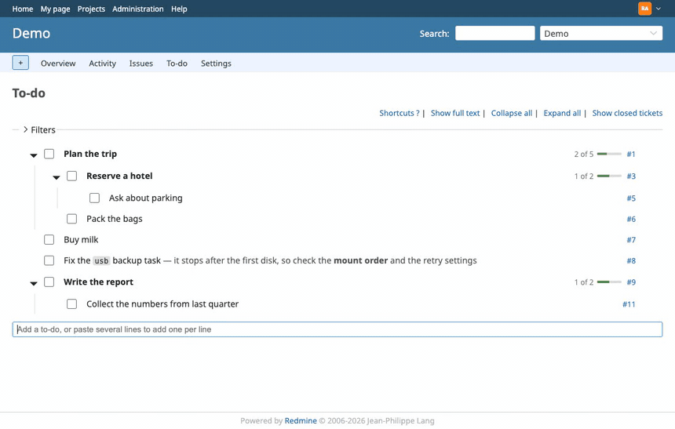
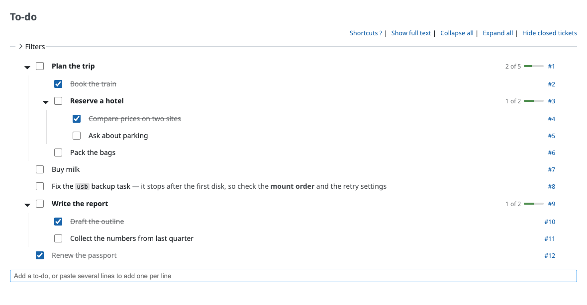
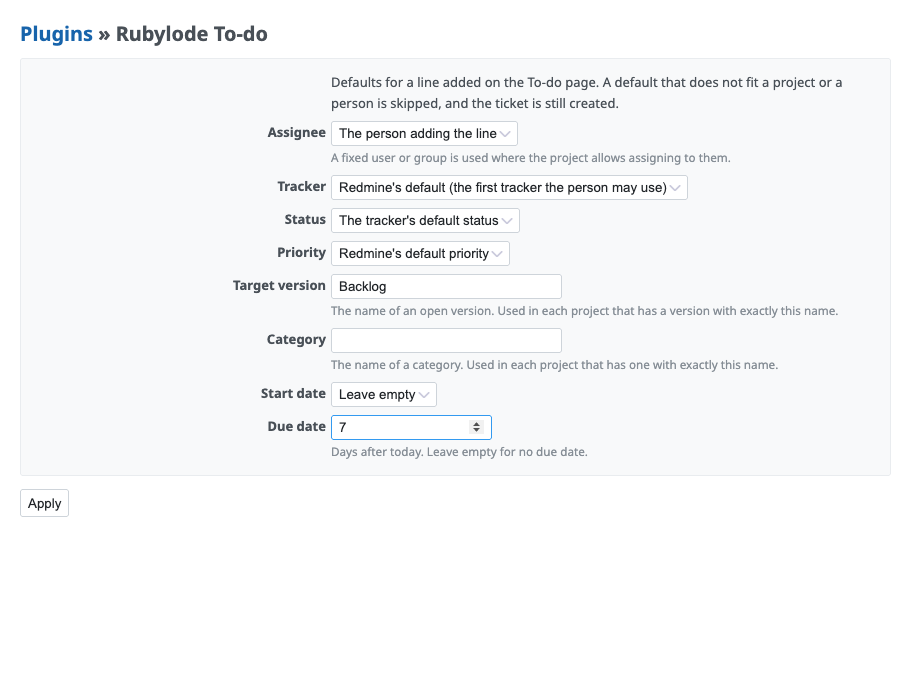
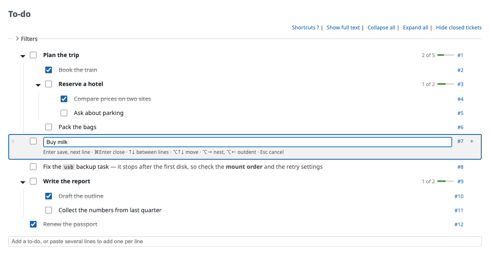
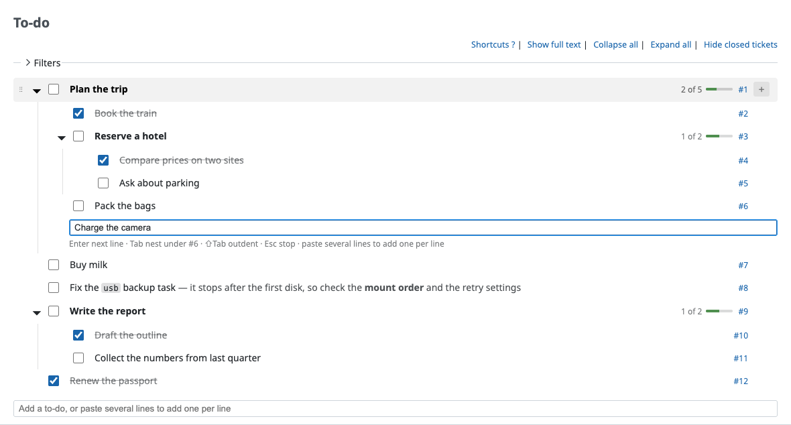
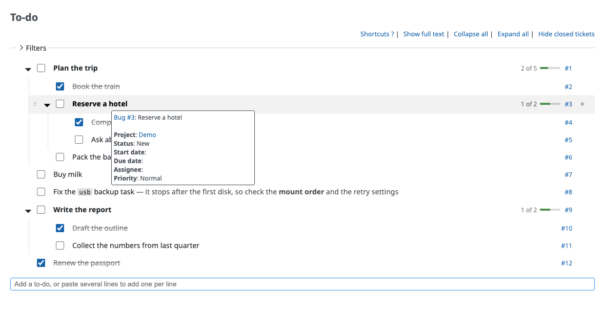
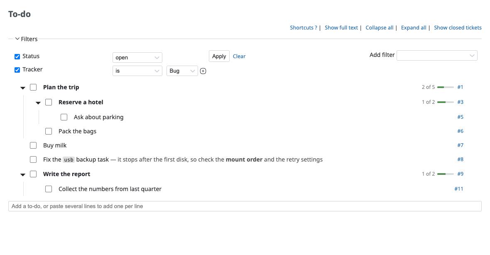
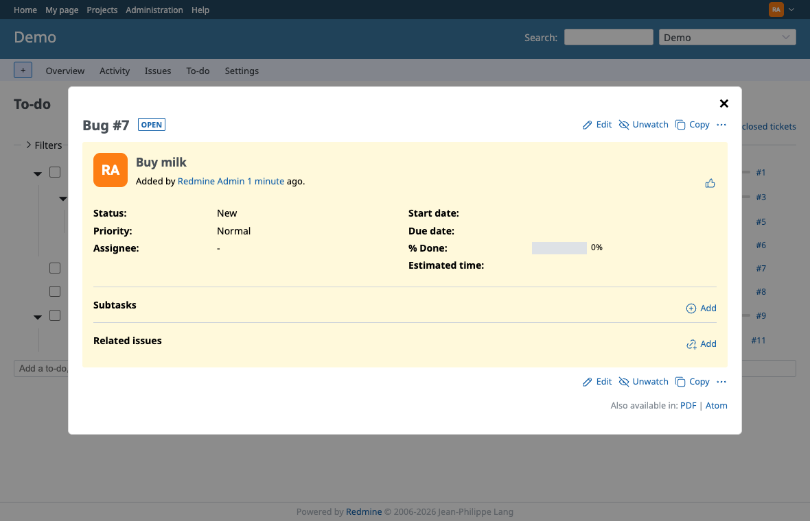
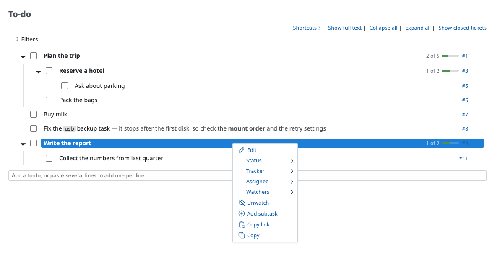
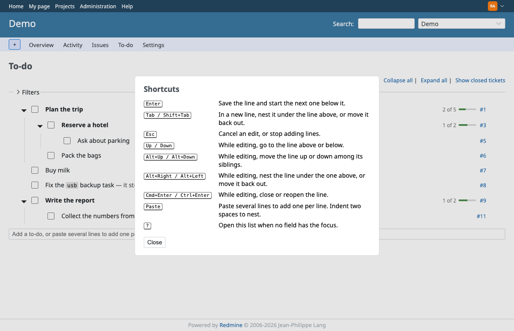

# Rubylode To-do for Redmine

TL;DR: a To-do page for every [Redmine](https://www.redmine.org) project, where each line is a real ticket.

Contents:

- [What it does](#what-it-does)
- [Installation](#installation)
- [Settings](#settings)
- [Screenshots](#screenshots)
- [Details](#details)
- [What's missing](#whats-missing)
- [Try it](#try-it)
- [Tests](#tests)
- [License](#license)
- [Disclaimer](#disclaimer)

I needed a flat list: do A, do B, one nested item under B. In Redmine that is three ticket forms and a dozen clicks,
and you can't see the list while you build it. So each project now gets a To-do page. Quick things happen in the list,
and anything bigger is one click away from the normal ticket edit.

## What it does

- Type at the bottom and press Enter to create a ticket. Enter again adds the next line, Tab nests it under the line
  above, and pasting a whole outline creates one ticket per line.
- Click a line to edit its subject in place. Up and Down move between lines, Alt+arrows move or nest a line, and
  Cmd+Enter ticks it.
- The checkbox closes a ticket, or reopens it, and crosses the line out. Close a parent and the open tickets below it
  close too, after one confirmation.
- Drag a line by its grip onto another to nest it, or onto an edge to reorder. Everyone on the project sees the same order.
- Parents fold, and show how many of their tickets are closed ("2 of 5") with a small progress bar.
- Redmine's own ticket filters narrow the list. Show closed tickets is the status filter.
- Click a ticket number and the ticket opens in a dialog over the list. Edit gives you the full form, with notes and
  file uploads.
- Hover a line for Redmine's ticket tooltip, right click for its context menu.
- Long subjects stop at two lines (Show full text shows them whole). `code`, **bold** and ~~strike~~ show as such, and
  the text after the first dash goes lighter, so the headlines scan.
- Every change is a normal ticket save, so workflow, permissions, journals and notification mails stay Redmine's. The
  mails still go out, so your watchers hear about every tick. That's on purpose.
- No settings page, no extra gem, no JavaScript library.

## Installation

Redmine 7.0 or newer, on any database Redmine supports. The plugin adds one small table for the line order. The folder
must be named `redmine_rubylode_todo`, the same as the plugin id.

1. Put the plugin in your Redmine's `plugins` folder:

       cd /path/to/redmine/plugins
       git clone https://github.com/rubylode/redmine-rubylode-todo.git redmine_rubylode_todo

   Or unpack a [release archive](https://github.com/rubylode/redmine-rubylode-todo/releases) there, as `redmine_rubylode_todo`.

2. Create the table:

       cd /path/to/redmine
       bundle exec rake redmine:plugins:migrate RAILS_ENV=production

3. Restart Redmine ([Passenger](https://www.phusionpassenger.com), [Puma](https://puma.io), whatever serves it).

4. Allow it, as an administrator:
   1. Administration, Roles and permissions: tick Use the to-do list for the roles that should see the page.
   2. Administration, Settings, Projects: tick To-do under Default enabled modules for new projects.
   3. Each existing project needs the module once (Settings, Modules). To do all of them at once:

          bundle exec rails runner -e production 'Project.find_each { |project| project.enable_module!(:rubylode_todo) }'

5. Open a project. A To-do tab now sits after Issues.

With [Docker](https://www.docker.com), mount or copy the plugin to `/usr/src/redmine/plugins/redmine_rubylode_todo`,
then migrate inside the container and restart it:

    docker compose exec redmine bundle exec rake redmine:plugins:migrate RAILS_ENV=production
    docker compose restart redmine

If the migration complains about a missing secret key, pass the one the container already uses:
`docker compose exec -e SECRET_KEY_BASE="$SECRET_KEY_BASE" redmine ...`.

To upgrade, `git pull`, run the migration again (it does nothing when there is nothing new) and restart.

To remove it, run the line below, delete the folder and restart. This drops the order table. Tickets are not touched.

    bundle exec rake redmine:plugins:migrate NAME=redmine_rubylode_todo VERSION=0 RAILS_ENV=production

## Settings

New lines get Redmine's own defaults, and the person adding the line is the assignee. To change that, open
Administration, Plugins, Rubylode To-do, Configure. One set of defaults applies to every project:

- Assignee: nobody, the person adding the line (the default), or a fixed user or group.
- Tracker, status and priority.
- Target version and category, by name. A project uses the default when it has an open version, or a category, with
  exactly that name.
- Start date (today) and due date (a number of days after today).

A default that doesn't fit is skipped, and the ticket is still created. That covers a status the workflow doesn't allow
for a new ticket, a closed version, a field the tracker has disabled and a field the person's role can't edit. A fixed
assignee is used only where the project allows assigning to them, and a group only when Redmine allows assigning to groups.

## Screenshots

Click a line to edit it. Enter saves and opens a new line below, like a notes app, with the keys listed underneath.

Press + on a line to add a line under it. Tab nests a new line under the one above, Shift+Tab moves it back out.

Hover for the ticket's tooltip, shown beside the pointer.

The filters are the ones the ticket list has, and the page keeps them while you tick, edit or move lines.

Click a ticket number to read or edit the ticket without leaving the list.

Right click for Redmine's own menu: status, tracker, assignee, watchers, edit, copy.

Press ? for the keys.

## Details

- Pasting several lines creates one ticket per line, up to 100. Two spaces or a tab nest a line under the one above, and
  list markers (`- `, `* `, `1. `, `- [ ] `) are dropped.
- New tickets get Redmine's default tracker, status and priority and are assigned to you, unless the settings say otherwise.
- A closed line stays in place, crossed out, until you reload the page. Reopening a parent asks the same question as
  closing one.
- Escape cancels an edit. Alt+Right nests the line you're editing under the one above, Alt+Left moves it back out.
- Collapse all and Expand all sit above the list. Folding is remembered per browser.
- Drop a line on the middle of another to make it a child, on the top or bottom edge to reorder.

## What's missing

- English only. The strings live in `config/locales/en.yml`; translations are welcome.
- There is no undo.
- It's built for a desktop browser. The phone experience isn't good (the grip is hidden on touch screens, so no
  dragging), and there are mobile apps that do this better.
- Links inside the ticket dialog (another ticket, a wiki page) leave the list.
- Drag and drop, the tooltip and the right-click menu have no automated test. Everything that changes a ticket does.

## Try it

A throwaway Redmine 7 runs from this folder, with the repository mounted as the plugin:

    docker compose up -d
    docker compose exec redmine bundle exec rake redmine:plugins:migrate
    docker compose restart redmine
    open http://localhost:3007

Sign in as admin (password admin, change it on first login), load the default data under Administration, create a
project, enable the To-do module and grant the permission. Wipe it with `docker compose down -v`.

## Tests

    bin/test                                      all integration tests
    bin/test test/integration/todo_moving_test.rb one file

They run in a Redmine 7 image with its test gems (`docker/test.Dockerfile`), send the requests a browser would send,
and check the tickets and the stored order. For the browser parts, try these in the throwaway Redmine:

1. Add a line, edit it, tick it, untick it (show closed tickets to find it).
2. Tick a parent that has open children. The confirmation names the count, and Cancel changes nothing.
3. Drag a line onto another, then to the top edge of a line, then out of its parent.
4. Hover a line for the tooltip, right click for the menu.
5. Open a ticket in the dialog, change the subject, save.

Pull Requests are welcome!

## License

GNU General Public License, version 2 or (at your option) any later version, the same as Redmine. See `LICENSE`.

Copyright (C) 2026 Nick Gorbikoff. Each Ruby file carries the same short notice Redmine puts on its own.

## Disclaimer

Use it at your own risk. It comes with no warranty of any kind, as the license says: the software is provided "as is",
without any promise that it works, that it fits your purpose or that it's free of bugs. I'm not liable for any damage,
data loss or downtime that comes from using it, installing it or removing it.

The plugin creates, edits, closes and reorders tickets in your Redmine, and adds one table to your database. Before you
install or upgrade it, back up your Redmine database, and try it on a test instance first. I've tested it on Redmine
7.0.2 and the 7.0 stable branch, and nothing else.
